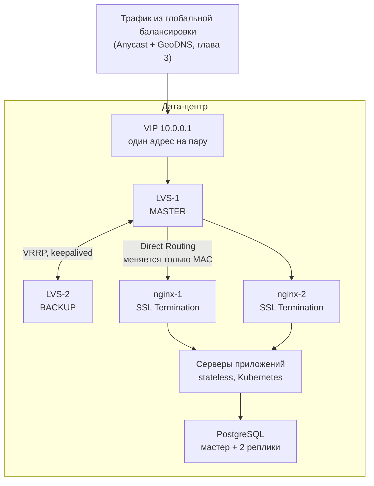
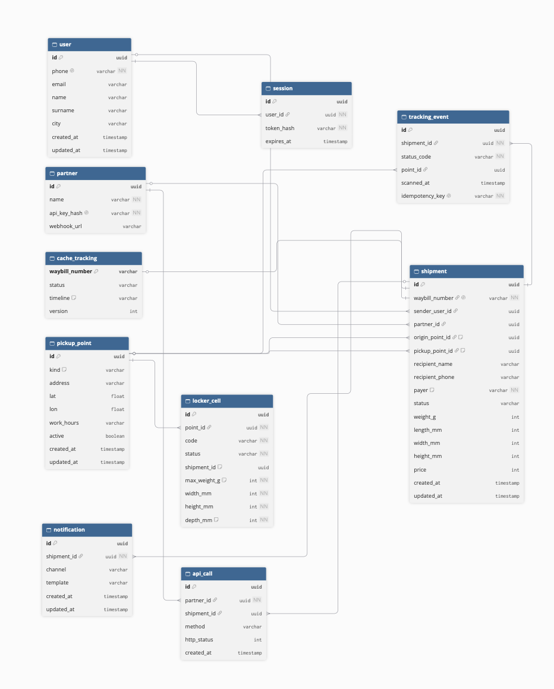
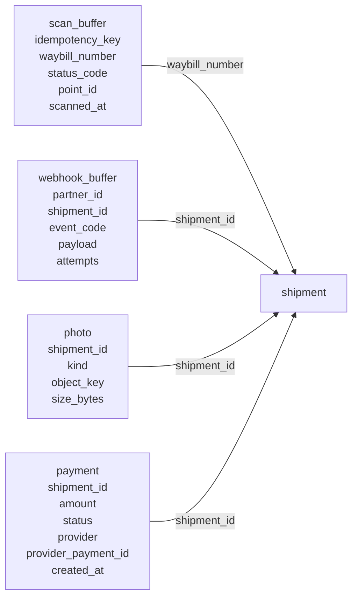
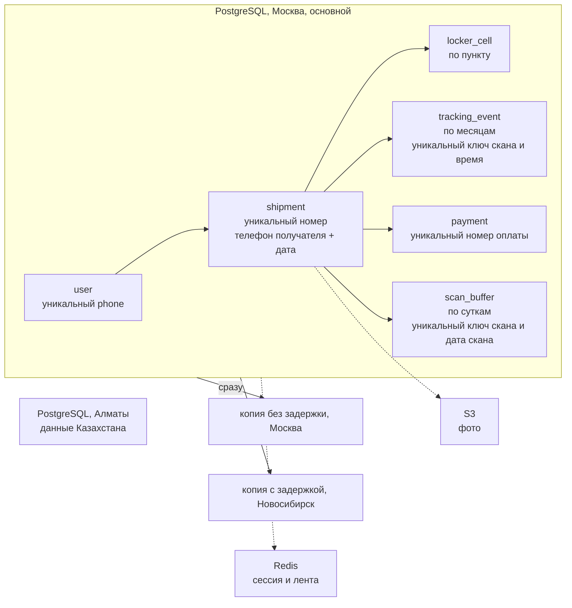

# Расчётно-пояснительная записка

**Дисциплина:** Проектирование высоконагруженных систем  
**Тема:** Бэкенд B2C-логистического сервиса: оформление отправлений, трекинг и управление сетью (на примере СДЭК)

## Оглавление
1. [Тема и целевая аудитория](#глава-1-тема-и-целевая-аудитория)  
2. [Расчёт нагрузки](#глава-2-расчёт-нагрузки)  
3. [Топология инфраструктуры и распределение нагрузки](#глава-3-топология-инфраструктуры-и-распределение-нагрузки)  
4. [Локальная балансировка нагрузки](#глава-4-локальная-балансировка-нагрузки)  
5. [Логическая схема БД](#глава-5-логическая-схема-бд)  
6. [Физическая схема БД](#глава-6-физическая-схема-БД-и-инфраструктура-хранения)  
7. [Алгоритмы](#глава-7-алгоритмы)  
8. [Источники](#источники)  

---

## Глава 1. Тема и целевая аудитория

### 1.1. Тема и рыночная ниша
Проектируется бэкенд логистического сервиса. Через него отправитель оформляет посылку, получатель следит за её движением, а пункты выдачи (ПВЗ) и курьеры сообщают системе о перемещении груза в реальном времени.  
**Реальный аналог:** СДЭК.  
За 2025 год через сервис прошло более 123 млн отправлений [1]. Компания обслуживает 18 млн физических лиц и имеет более 8800 ПВЗ и постаматов [2].

### 1.2. Ключевые особенности системы
Эти особенности напрямую влияют на архитектуру:
1. **Два потока записи.** Заказы создают пользователи, но основной поток изменений статуса генерируют сканеры на складах и терминалы ПВЗ.
2. **Публичный трекинг.** Статус посылки можно узнать по номеру накладной без входа в аккаунт. Это значит, что трафик не всегда привязан к сессии пользователя, но его можно эффективно кэшировать по номеру посылки.
3. **Партнёрский API.** Значительная часть заказов создается автоматически через интеграции с интернет-магазинами.
4. **Постаматы как объект состояния.** Система хранит не только статус посылки, но и занятость каждой ячейки постамата, превращая справочник в часто обновляемое состояние.

### 1.3. Функционал MVP
1. Оформление отправления (расчет стоимости, выбор ПВЗ, создание накладной).
2. Приём событий от сети (сканы ТСД, терминалов ПВЗ, геотреки).
3. Трекинг (лента событий посылки для пользователя и публично по номеру).
4. География и сеть (справочник ПВЗ, режим работы, занятость ячеек).
5. Уведомления (Push и SMS при смене статуса).
6. Регистрация и авторизация.
7. Партнёрский API (создание накладных оптом, опрос статусов, исходящие вебхуки интернет-магазинам).

### 1.4. Расчёт аудитории (MAU и DAU)
Аудитория считается от реального физического объема бизнеса (числа отправлений).

**Опорные величины:**
| Обозначение | Величина | Значение | Источник |
| :--- | :--- | :--- | :--- |
| `P_год` | Отправлений за 2025 г. | 123 млн | [1] |
| `P_сут` | Отправлений в сутки (среднее) | 337 тыс. | 123 млн / 365 дней |
| `C_год` | Физических лиц в базе | 18 млн | [2] |
| `N_пвз` | ПВЗ и постаматов | 8800 | [2] |

*Проверка `P_сут`:* в отчёте эмитента за III квартал 2025 года указан среднесуточный объём 318,6 тыс. накладных [4]. Наш расчёт даёт 337 тыс. — расхождение 6%, что объяснимо: III квартал не включает предновогодний пик. Две независимые цифры сходятся.

Расхождение: `(337 − 318,6) / 318,6 = 5,8%`, в тексте округлено до 6%.

**Расчёт месячной аудитории (MAU):**
1. **Получатели:** В месяц приходит 10,25 млн посылок (123 млн / 12). Согласно структуре отправлений [3], чисто корпоративные B2B-грузы составляют 7%. Следовательно, 93% отправлений (10,25 млн × 0,93 = 9,53 млн) приходится на сегменты с участием физических лиц (B2C, C2C, международные). 
   *Обоснование частоты:* средний онлайн-покупатель делает 19 заказов в год, то есть ~1,6 в месяц [12] (`19 / 12 = 1,58`). Часть заказов уходит другим операторам доставки (маркетплейсы, Почта), поэтому через один сервис человек получает реже — берём 1,5 посылки в месяц. 
   *Допущение:* отдельного замера «посылок СДЭК на человека в месяц» нет. 1,5 — это 1,58 из [12], округлённые вниз на одну десятую.
   *Расчет уникальных получателей:* `9,53 млн / 1,5 = 6,36 млн`.
2. **Отправители (C2C):** На сегмент C2C приходится 15% [3] от всех отправлений (1,54 млн в месяц: `10,25 × 0,15 = 1,54`). 
   *Допущение по частоте:* отправления C2C (продажа на Авито, подарки) эпизодические. Берём 1,25 отправления на активного отправителя в месяц: одно отправление и редкий повтор в том же месяце. Опубликованной частоты нет.
   *Расчет уникальных отправителей:* `1,54 млн / 1,25 = 1,23 млн`. 
   *Допущение по пересечению:* кто отправляет, тот обычно и получает. Берём 60% уже учтённых как получатели; замера пересечения нет. Добавляем уникальных: `1,23 млн × (1 − 0,60) = 1,23 млн × 0,40 = 0,49 млн`.
3. **Пользователи без активной посылки — 3,0 млн.** Это люди, которые открывают сервис, но не участвуют в отправлении или получении именно в этом месяце. Они заходят, чтобы рассчитать тариф перед покупкой, найти ближайший ПВЗ, отследить через приложение посылки других служб доставки (приложение поддерживает трекинг более 100 операторов — так устроен продукт, отдельной публикации с этим числом в списке источников нет) или зайти в программу лояльности.
   
   *Обоснование цифры:* Месячная аудитория мобильного приложения превышала 4 млн ещё до перезапуска в формате SuperApp [5], после которого активная аудитория выросла на 43% [6], то есть составила `4 × 1,43 = 5,72 ≈ 5,7 млн` только в мобильном канале. Транзакционные пользователи — `6,36 + 0,49 = 6,85 млн`. 
   *Допущение по каналам:* на приложение приходится 60% транзакционных пользователей (`6,85 × 0,60 = 4,1 млн`); замера доли каналов нет. Остаток приложения: `5,7 − 4,1 = 1,6 млн` — нетранзакционные пользователи мобильного канала. Веб, где сидят анонимный трекинг и расчёт тарифов, — ещё 1,4 млн; это тоже допущение, отдельной веб-аудитории в источниках нет. Итого: `1,6 + 1,4 = 3,0 млн`.

**Итого MAU:** `6,36 + 0,49 + 3,00 = 9,85 млн человек`.

**Расчёт суточной аудитории (DAU):**
Средний жизненный цикл посылки — 5 суток. Согласно [11] доставка от 1 до 10 суток. Середина диапазона `(1 + 10) / 2 = 5,5`; распределение внутри диапазона не опубликовано, в расчёт берём 5 суток — округление середины вниз. Посылок в системе одновременно в день: `337 тыс. × 5 = 1,68 млн`.

*Допущение:* делитель 1,25 здесь — не частота C2C из расчёта MAU, а число посылок одновременно у одного получателя (у части людей в пути две). Замера нет. Получателей с активной посылкой: `1,68 / 1,25 = 1,35 млн`.

Получатель заходит в приложение не каждый день, а в 3 дня из 5: при создании, при прибытии в город и при готовности к выдаче. Это три названных события на цикл в 5 суток, не отдельная статистика визитов. Активных получателей в сутки: `1,35 × (3/5) = 0,81 млн`.

| Составляющая DAU | Расчёт | Значение, млн |
| :--- | :--- | ---: |
| Получатели с активной посылкой | 1,35 × 3/5 | 0,81 |
| Отправители C2C | 337 тыс. × 15% × 2 | 0,10 |
| Пользователи без активной посылки | 3,0 млн × 8% | 0,24 |
| Анонимный трекинг и кабинеты магазинов | допущение | 0,20 |
| **Итого DAU** | | **1,35** |

Множитель 2 у отправителей C2C — допущение: оформление и сдача в ПВЗ это два захода. `337 тыс. × 0,15 × 2 = 0,101 млн`, в таблице 0,10. Доля 15% — [3].

*Допущение показателя 8%:* у пользователя с активной посылкой 3 дня из 5, то есть около 60%. У периферийной аудитории повода заходить каждый день нет. 8% — это в среднем один визит в `1 / 0,08 ≈ 12–13` дней (тариф, программа лояльности). Отраслевого замера именно для нетранзакционного сценария логистики нет; [7] задаёт 10–20% для DAU/MAU всего приложения, не эту строку.

*Допущение 0,20 млн:* публичные открытия по номеру накладной и кабинеты магазинов. Отдельного счётчика визитов нет, строка добавлена оценкой.

*Проверка:* `DAU / MAU = 1,35 / 9,85 = 13,7%`. Для потребительских приложений сводка со ссылкой на Sequoia даёт 10–20% [7].

---

## Глава 2. Расчёт нагрузки

### 2.1. Коэффициенты пиковой нагрузки
Пиковый RPS раскладывается на множители: `K = K_сезон × K_час`.

Опубликованного суточного профиля СДЭК нет, поэтому оба множителя — допущения:
- `K_сезон = 2,2` — декабрь и дни распродаж к среднему дню. [1] называет декабрь пиком, но кратность не приводит.
- `K_час = 1,80` — вечерний час с учётом нескольких часовых поясов: пик страны ниже, чем был бы в одном поясе.

Для пользовательского трафика: `2,2 × 1,80 = 3,96`. Для фоновых системных процессов коэффициенты ниже, так как они более равномерны.

| Контур | K | Почему |
| :--- | ---: | :--- |
| Пользовательский | **3,96** | `2,2 × 1,80` |
| Операционный (склады, ПВЗ) | **4,0** | `2,2 × 1,80 = 3,96`, округление до 4,0. Сезон и ночное окно сортировки; внутри часа поток ровный |
| Партнёрский API (создание накладных) | **6,0** | Допущение для пакетных выгрузок: `3,0 × 2,0 = 6,0`. Сезон 3,0 выше пользовательского 2,2, час 2,0 — выгрузки сходятся в более узкое окно |
| Опрос статусов, геотреки | **2,2** | Допущение: работают по расписанию, от суточного профиля остаётся только сезон |
| Телеметрия постаматов, выгрузка справочника | **1,2** | Допущение: таймеры расходятся, до 20% устройств могут совпасть, `1 + 0,2 = 1,2` |

### 2.2. Маршрут посылки: 15 событий трекинга
Это ключевая величина главы: от неё считаются и сканы складов, и вебхуки, и уведомления, и объём истории в БД. Каждое событие — одно сканирование на ТСД или терминале ПВЗ. Число 15 — длина перечисленной цепочки, не внешняя статистика:

приём у отправителя → приёмка на складе отправления → сортировка → погрузка на магистраль → отправка рейса → прибытие в транзитный хаб → сортировка в хабе → погрузка → прибытие в город получателя → приёмка на складе → сортировка на доставку → передача курьеру или в ПВЗ → прибытие в ПВЗ → готово к выдаче → выдано. **Итого 15 сканов.**

Из этих 15 событий:
- **5 интересны интернет-магазину** (приём, отправка рейса, прибытие в город, готово к выдаче, выдано) — столько вебхуков мы отправляем партнёру, остальные `15 − 5 = 10` это внутренние перемещения;
- **4 уходят push-уведомлением получателю** (принята, прибыла в город, готова к выдаче, выдана).

### 2.3. Сводная таблица RPS (запросов в секунду)

| Тип запроса | Контур | Запросов, млн/сут | Средний RPS | Пиковый RPS |
| :--- | :--- | ---: | ---: | ---: |
| Просмотр карточки отслеживания | Пользовательский | 4,05 | 47 | 186 |
| Приём сканов ТСД и ПВЗ | Операционный | 5,05 | 58 | 234 |
| Старт сессии (bootstrap) | Пользовательский | 2,70 | 31 | 124 |
| Подсказки адреса и карта ПВЗ | Пользовательский | 1,87 | 22 | 86 |
| Геотреки курьеров | Операционный | 2,88 | 33 | 73 |
| Отправка push и SMS | Уведомления | 1,25 | 14 | 70 |
| Исходящие вебхуки магазинам | Партнёрский | 1,38 | 16 | 64 |
| Опрос статусов партнёрами (API) | Партнёрский | 2,36 | 27 | 60 |
| Телеметрия занятости ячеек постаматов | Операционный | 2,53 | 29 | 35 |
| Создание накладных по API | Партнёрский | 0,28 | 3 | 19 |
| Проверка свободных ячеек пользователями | Пользовательский | 0,40 | 5 | 18 |
| Оформление отправления | Пользовательский | 0,30 | 3 | 14 |
| Выгрузка справочника ПВЗ партнёрами | Партнёрский | 0,20 | 2 | 3 |
| Добавление и изменение ПВЗ | Административный | 0,0003 | <0,01 | <0,1 |
| **ИТОГО** | | **~25,3** | **~292** | **~986** |

*Как считалось:*

**Исходные данные:** DAU = 1,35 млн; отправлений в сутки = 337 тыс.; активных посылок в системе = 1,68 млн (337 тыс. × 5 суток жизненного цикла); партнёрских отправлений в сутки = 276 тыс. (337 тыс. × 82%: доли B2C 75% и B2B 7% [3]).

**Формулы:**
- `Запросов, млн/сут = Число действий × API-вызовов на действие`
- `Средний RPS = (Запросов, млн/сут × 1 000 000) / 86 400`
- `Пиковый RPS = Средний RPS × Коэффициент пика`

**Расчёт по строкам (млн/сут) с пояснениями, откуда берутся цифры:**

- **Просмотр трекинга (4,05):** 1,35 млн заходов в сервис × 3 запроса. Пользователь открывает приложение: сначала грузится список его посылок, потом он кликает на одну (второй запрос), и грузится история её перемещений (третий запрос).
- **Приём сканов ТСД (5,05):** 337 тыс. посылок в сутки × 15 сканов на каждую (полный путь посылки от приёмки до выдачи: приём → сортировка → магистраль → хаб → город → ПВЗ → выдача, с промежуточными узлами).
- **Старт сессии (2,70):** 1,35 млн заходов × 2 запроса. При входе в приложение клиент сначала обновляет токен безопасности, а потом скачивает базовые настройки (например, какие баннеры показать).
- **Подсказки адреса и карта ПВЗ (1,87):** Здесь складываются два действия:
  1. *Работа с картой (1,62 млн):* Когда человек выбирает пункт выдачи на карте, приложение делает 6 запросов к серверу:
     - Запрос 1: Просто загрузить саму карту, чтобы она отрисовалась.
     - Запрос 2: Скачать точки ПВЗ, которые видны на экране сейчас (чтобы не грузить все 8800 точек сразу и не вешать телефон).
     - Запрос 3: Человек подвинул карту пальцем — подгрузились новые точки для этого района.
     - Запрос 4: Человек кликнул на точку — подгрузился её адрес и часы работы.
     - Запрос 5: Проверка, есть ли свободные ячейки в выбранном постамате.
     - Запрос 6: Проверка, примет ли этот конкретный ПВЗ посылку такого веса и размера.
     *Допущение:* карту открывает каждый пятый из DAU, `1,35 / 5 = 0,27 млн`. Доли сессий с картой в открытых данных нет. *Считаем:* `0,27 × 6 = 1,62 млн`.
  2. *Ввод адреса вручную (0,25 млн):* *Допущение:* пока человек набирает адрес, уходит 5 запросов автодополнения. Оформлений в интерфейсе — только C2C: `337 тыс. × 15% = 50,5 тыс.` [3]. *Считаем:* `50,5 тыс. × 5 = 0,25 млн`.
  Сумма строки: `1,62 + 0,25 = 1,87`.
- **Геотреки курьеров (2,88):** Курьером «до двери» едет 21% посылок [13], это `337 тыс. × 0,21 = 71 тыс.` доставок в сутки. *Допущения, замера парка нет:* 30 доставок на курьера за смену, смена 10 часов, координата раз в 30 секунд. Курьеров: `71 тыс. / 30 ≈ 2 400`. Точек за смену: `10 × 3 600 / 30 = 1 200`. *Считаем:* `2 400 × 1 200 = 2,88 млн`.
- **Push/SMS (1,25):** посылок для физлиц `337 тыс. × 93% = 313 тыс.` (93% — из раздела 1.4, все сегменты кроме B2B). `313 тыс. × 4` уведомления. *Допущение пика:* 40% уведомлений «готово к выдаче» уходят в одно окно 30 минут, когда склад заканчивает сортировку к открытию. `313 тыс. × 0,40 / (30 × 60) = 70 RPS`.
- **Вебхуки партнёрам (1,38):** 276 тыс. партнёрских посылок × 5 событий из раздела 2.2. Пик: средний RPS × 4,0 (операционный коэффициент, вебхук уходит в момент скана).
- **Опрос партнёрами (2,36):** *Допущения:* 35% активных посылок принадлежат магазинам без вебхука, каждый такой магазин опрашивает посылку 4 раза в сутки. `1,68 млн × 0,35 × 4 = 2,35 млн`, в таблице 2,36.
- **Телеметрия ячеек постаматов (2,53):** *Допущение:* постаматы — 20% точек сети, `8 800 × 0,20 = 1 760`. Разбивки «ПВЗ / постамат» в [2] нет, там одна сумма. Каждый постамат шлёт отчёт раз в минуту: `24 × 60 = 1 440`. *Считаем:* `1 760 × 1 440 = 2,53 млн`.
- **Создание накладных по API (0,28):** 276 тыс. партнёрских посылок × 1 запрос на создание. Пик × 6,0.
- **Проверка свободных ячеек (0,40):** пользователи с карты, те же 0,27 млн, плюс курьеры при закладке: *допущение* — в постамат едет те же 20% посылок, `337 тыс. × 0,20 = 67 тыс.`, по 2 запроса. `0,27 + 67 тыс. × 2 / 1 000 000 = 0,40`.
- **Оформление отправления (0,30):** шесть шагов, каждый — отдельный запрос: стоимость, проверка адреса, слот на дату, запись заказа, сессия оплаты, подтверждение оплаты. `50,5 тыс. × 6 = 0,30 млн`.
- **Выгрузка справочника ПВЗ (0,20):** более 200 тыс. магазинов-партнёров [4] раз в сутки скачивают список ПВЗ. `200 000 / 1 000 000 = 0,20`.
- **Добавление и изменение ПВЗ (0,0003):** *Допущение:* карточка точки (телефон, режим) обновляется в среднем раз в месяц. `8 800 × 12 / 365 = 289` правок в сутки, в таблице округлено до 300, то есть 0,0003 млн.

**Про две строки с маленьким RPS.** Добавление ПВЗ даёт меньше 0,01 RPS и на выбор железа не влияет, но строку нельзя убирать: справочник ПВЗ читают все остальные контуры (карта, оформление, выгрузка партнёрам, маршрутизация посылок), поэтому запись в него должна быть строго консистентной и обязана сбрасывать кеши карты и партнёрских выгрузок. То же с ячейками: `2,53 + 0,40 = 2,93` млн запросов в сутки и `35 + 18 = 53` RPS в пике. Таблица — десятки мегабайт и обновляется в одной транзакции с накладной (глава 6).

### 2.4. Хранение данных
| Тип данных | шт./мес | Размер записи | ГБ/мес | Срок хранения |
| :--- | ---: | ---: | ---: | :--- |
| События трекинга | 151,6 млн | 0,40 КБ | 60,7 | 36 мес |
| Накладные и заказы | 10,2 млн | 4,00 КБ | 41,0 | 60 мес |
| Журнал партнёрского API | 126,6 млн | 0,25 КБ | 31,7 | 3 мес |
| Геотреки курьеров | 86,4 млн | 0,06 КБ | 5,2 | 3 мес |
| Фотофиксация (объектное хранилище) | 5,1 млн | 250 КБ | 1281,0 | 12 мес |
| **Итого структурных (сырые)** | | | **~139 ГБ/мес** | |

*Как считалось:*

**Исходные данные:** отправлений в год = 123 млн; отправлений в сутки = 337 тыс.; отправлений в месяц = 10,25 млн.

**Расчёт по строкам (шт./мес):**
- **События трекинга (151,6 млн):** 337 тыс. посылок/сут × 15 событий на посылку × 30 дней = 151,65 млн. ГБ: `151,6 млн × 0,40 КБ / 1 000 = 60,6 ГБ`, в таблице 60,7.
- **Накладные и заказы (10,2 млн):** 123 млн посылок/год / 12 месяцев = 10,25 млн. `10,25 × 4,00 / 1 000 = 41,0 ГБ`.
- **Журнал партнёрского API (126,6 млн):** сумма партнёрских строк таблицы 2.3 (2,36 опросов + 1,38 вебхуков + 0,28 созданий + 0,20 выгрузок = 4,22 млн/сут) × 30 дней = 126,6 млн. `126,6 × 0,25 / 1 000 = 31,7 ГБ`.
- **Геотреки курьеров (86,4 млн):** 2,88 млн точек в сутки (расчёт в разделе 2.3) × 30 дней. `86,4 × 0,06 / 1 000 = 5,2 ГБ`.
- **Фотофиксация (5,1 млн):** *Допущение:* фото есть у 25% посылок (ценные грузы и спорные случаи), по 2 снимка — приём и выдача. `10,25 × 0,25 × 2 = 5,125 млн`. `5,125 × 250 / 1 000 = 1 281 ГБ`.

**Размеры записей — допущение по составу полей, не замер строк в бою:**
- Событие трекинга (0,4 КБ): ID посылки, timestamp, код статуса, ID точки, ID сотрудника, координаты GPS, метаданные.
- Накладная (4,0 КБ): данные отправителя/получателя, габариты, вес, тариф, стоимость, состав вложения, метаданные.
- Журнал API (0,25 КБ): timestamp, ID партнёра, тип запроса, ID посылки, HTTP-статус ответа.
- Геотрек (0,06 КБ): ID устройства, timestamp, широта, долгота, скорость, направление.
- Фото (250 КБ): *допущение* — JPEG после сжатия, который принимаем на загрузку. Это не размер сырого кадра на 12 МП.

**Сроки хранения:**
- События трекинга (36 мес): общий срок исковой давности 3 года [16].
- Накладные (60 мес): первичный учётный документ, не меньше 5 лет [17].
- Журнал API и геотреки (3 мес): *допущение* — окно разбора инцидента и отладки интеграции. Отдельного законного минимума для этих журналов нет.
- Фото (12 мес): *допущение* — срок, на котором разбираем спор о повреждении. Хранятся в объектном хранилище (S3).

**Итоговый объём:** 60,7 + 41,0 + 31,7 + 5,2 = 138,6 ГБ/мес сырых данных (округляем до 139 ГБ/мес). Фотофиксация (1281 ГБ/мес) хранится отдельно в S3 и не нагружает основную СУБД.

*Расчет накладных расходов СУБД:*  
Сырые данные: 139 ГБ/мес.  
*Допущение ×1,6:* вторичные индексы и WAL примерно +60% к сырому объёму. Отдельного замера доли индексов нет. `139 × 1,6 = 222 ГБ/мес`.  
Три копии — мастер и две реплики, как на схеме главы 4: `222 × 3 = 666 ГБ/мес ≈ 0,67 ТБ/мес`.  
Верхняя оценка, если хранить весь поток 36–60 месяцев в трёх копиях: `0,67 × 36 ≈ 24 ТБ` … `0,67 × 60 ≈ 40 ТБ`. По таблицам главы 6 один PostgreSQL — **5,5 ТБ**, три копии — **16,5 ТБ**. Фото в S3 в эту сумму не входят.

**Средний размер хранилища на пользователя:** `139 ГБ/мес × 36 мес / 9,85 млн MAU = 508 КБ ≈ 0,5 МБ` структурных данных. Фото: `1 281 ГБ/мес × 12 мес / 9,85 млн ≈ 1,6 МБ`.

### 2.5. Сетевой трафик
Трафик по типу = пиковый RPS × средний размер ответа.

| Тип трафика | Размер ответа | Пиковый RPS | Пик, Мбит/с | ГБ/сут |
| :--- | ---: | ---: | ---: | ---: |
| Пользовательские ответы (трекинг, карта, сессия, ячейки, оформление) | ~10 КБ | 428 | 35 | 93 |
| Выгрузка справочника ПВЗ партнёрами | 500 КБ | 3 | 12 | 100 |
| Машинный трафик (сканы, геотреки, вебхуки, опрос статусов, телеметрия, уведомления, создание накладных) | ~1 КБ | 555 | 5 | 16 |
| Загрузка фотофиксации в объектное хранилище | 250 КБ | 8 | 16 | 43 |
| **ИТОГО** | | **986** | **~68 (0,07 Гбит/с)** | **~250** |

Пиковые RPS групп — сумма строк таблицы 2.3:
- пользователи: `186 + 124 + 86 + 18 + 14 = 428`;
- справочник: 3;
- машины: `234 + 73 + 70 + 64 + 60 + 35 + 19 = 555` (последние 19 — создание накладных по API);
- фото: `5,1 млн / 30 / 86 400 = 2,0 RPS` в среднем, `× 3,96 = 8 RPS` (тот же пользовательский коэффициент: снимок делает человек на приёме и на выдаче). Фото в итог RPS таблицы 2.3 не входит: загрузка идёт в объектное хранилище мимо серверов приложений. В сумме канала эти 16 Мбит/с учтены.

ГБ/сут — из суточного числа запросов, не из пика: пользователи `4,05 + 2,70 + 1,87 + 0,40 + 0,30 = 9,32 млн × 10 КБ = 93 ГБ`; справочник `0,20 млн × 500 КБ = 100 ГБ`; машины около 16 ГБ при ~1 КБ; фото `5,1 млн / 30 × 250 КБ = 43 ГБ`. Сумма `93 + 100 + 16 + 43 = 252`, в таблице ~250.

Мбит/с: `RPS × килобайты × 8 / 1 000` при размере в килобайтах, для 10 КБ как 10 × 1024 байт: `428 × 10 × 1 024 × 8 / 10^6 = 35`.

**Выводы:**
- Пиковая нагрузка на канал — около **0,07 Гбит/с** (`68 / 1 000`), то есть стандартного интерфейса 1 Гбит/с хватает более чем десятикратно (`1 / 0,07 ≈ 14`). Система ограничена количеством запросов (RPS) и скоростью базы данных, а не шириной канала.
- Самый «тяжёлый по байтам» метод — выгрузка справочника ПВЗ: всего 3 RPS, но 500 КБ на ответ дают 100 ГБ/сут, то есть **40% суточного трафика** (`100 / 250`) **при 0,8% запросов** (`0,20 / 25,3`). Отсюда проектное решение: справочник надо отдавать инкрементально (только изменения с момента последней синхронизации) и со сжатием.
- Фото загружаются напрямую в объектное хранилище по presigned URL, минуя серверы приложений, поэтому их 16 Мбит/с не нагружают балансировщики.

---

## Глава 3. Топология инфраструктуры и распределение нагрузки

### 3.1. Расположение дата-центров (ЦОД)
Для обеспечения скорости и надежности используются три дата-центра:
1. **Москва:** Основной хаб. Здесь находится большая часть пользователей и центральные офисы.
2. **Новосибирск:** Географический центр. Обеспечивает низкую задержку для пользователей Урала, Сибири и Дальнего Востока — это УФО, СФО и ДФО, где живёт 36,6 млн человек, то есть 25% населения страны [10].
3. **Алматы:** Хаб для стран СНГ. **Важно:** законодательство Казахстана требует, чтобы персональные данные граждан РК хранились на территории страны [8, 9]. Поэтому для казахстанского сегмента выделен отдельный, изолированный контур в Алматы.

### 3.2. Распределение нагрузки

- **Пользовательский трафик** (мобильное приложение, сайт) направляется в ближайший ЦОД (Москва или Новосибирск) для максимальной скорости отклика.
- **Фоновый машинный трафик** (сканы со складов, вебхуки интернет-магазинам, рассылка уведомлений) не требует мгновенной реакции человека. Cпециально направляем около 50% этого трафика в Новосибирск. Это выравнивает нагрузку: Москва не перегружается, а Новосибирск работает в полную силу, а не простаивает как «холодный» резерв.

### 3.3. Распределение нагрузки и ёмкость (защита от каскадного отказа)

Для избежания сценария каскадного отказа и оптимизации затрат на инфраструктуру применён принцип «Равная производственная мощность, взвешенная маршрутизация». 

Чтобы система выдержала падение любого одного из трёх ЦОД, оставшиеся два должны быть способны принять его нагрузку. Следовательно, физическая ёмкость каждого ЦОД настроена на **55% от пиковой нагрузки всей системы** (что даёт 50% для покрытия чужой нагрузки + 5% запаса безопасности).

| ЦОД | Доля трафика (норма) | Физическая ёмкость | Свободный резерв |
| :--- | :---: | :---: | :---: |
| Москва | 40 % | 55 % | 15 % |
| Новосибирск | 30 % | 55 % | 25 % |
| Алматы | 30 % | 55 % | 25 % |
| **ИТОГО** | **100 %** | **165 %** | **65 %** |

**Сценарии аварийной ситуации (математика отказоустойчивости):**

- **Сценарий 1: Падение Москвы (40% трафика).**  
  Нагрузка равномерно распределяется на Новосибирск и Алматы (+20% к каждому).  
  - Новосибирск: 30% + 20% = 50% (не превышает ёмкость 55%).  
  - Алматы: 30% + 20% = 50% (не превышает ёмкость 55%).  
  *Система работает без деградации.*  

- **Сценарий 2: Падение Новосибирска (30% трафика).**  
  Нагрузка распределяется на Москву и Алматы (+15% к каждому).  
  - Москва: 40% + 15% = 55% (равно максимальной ёмкости 55%).  
  - Алматы: 30% + 15% = 45% (не превышает ёмкость 55%).  
  *Система работает без деградации.*

- **Сценарий 3: Падение Алматы (30% трафика).**  
  Нагрузка распределяется на Москву и Новосибирск (+15% к каждому).  
  - Москва: 40% + 15% = 55% (равно максимальной ёмкости 55%).  
  - Новосибирск: 30% + 15% = 45% (не превышает ёмкость 55%).  
  *Система работает без деградации.*  
  *(Важно: из-за требований законодательства РК о локализации данных, персональные данные граждан РК не покидают контур Алматы. При его падении казахстанский сегмент временно переходит в режим «только чтение» для публичного трекинга, пока узел не будет восстановлен).*

### 3.4. Сети и балансировка (Anycast и GSLB)
- **Anycast-подсеть `185.X.X.0/24`:** используется для публичного API (мобильное приложение B2C, трекинг, ТСД курьеров). Анонсируется со всех 3-х ЦОД через BGP, что позволяет маршрутизировать трафик до ближайшего узла на сетевом уровне.
- **GeoDNS (GSLB):** используется для веб-интерфейса. Отдельные пулы GSLB-записей выделены для казахстанского сегмента, чтобы направлять локальный трафик в Алматы и соблюдать регуляторные требования РК.

---

## Глава 4. Локальная балансировка нагрузки

### 4.1. Схема балансировки и механизмы резервирования

Внутри ЦОД балансировка многоуровневая: каждый уровень решает свою задачу и имеет свою защиту от сбоев.

| Уровень | Технология | Задача | Механизм резервирования |
| :--- | :--- | :--- | :--- |
| **Глобальный (L3)** | Anycast (BGP) + GeoDNS | Направление пользователя в ближайший дата-центр (Москва, Новосибирск или Алматы). | Маршрутизация на уровне провайдеров. При падении одного ЦОД трафик автоматически уходит в другой. |
| **Сетевой (L4)** | LVS (Linux Virtual Server) в режиме Direct Routing (DR) | Приём миллионов пакетов и очень быстрая передача их на серверы приложений без изменения IP-адреса. | Протокол **VRRP** (через `keepalived`). Один узел работает (MASTER), второй ждёт в резерве (BACKUP). |
| **Прикладной (L7)** | Nginx | Расшифровка HTTPS (SSL Termination), умная маршрутизация по URL, защита от медленных клиентов (буферизация). | Режим **Active-Active**. Все узлы работают одновременно и делят нагрузку. |
| **Внутренний** | kube-proxy / Service в Kubernetes | Балансировка межсервисных вызовов и service discovery. | Экземпляр попадает в реестр только после успешной readiness-пробы, упавший перезапускается на другом узле. |

**Почему Direct Routing.** Обратный трафик в разы больше входящего: пользователь отправляет короткий запрос, а получает карточку на 8 КБ или список точек карты. При режиме NAT весь ответный поток шёл бы через балансировщик и грузил его процессор, а при Direct Routing ответы идут от серверов приложений напрямую клиенту. Плата за это — все серверы должны быть в одной физической сети, но внутри одного ЦОД это выполняется.

**Проверка работоспособности узлов.** `keepalived` считает узел живым, если тот отвечает на HTTP-запрос `GET /healthz`, а не просто принимает TCP-соединение: nginx может держать порт открытым, когда приложение за ним уже недоступно.

### 4.2. Формула резервирования

| Формула | Смысл | Где применяем | Почему |
| :--- | :--- | :--- | :--- |
| **N + 1** | N узлов держат пиковую нагрузку, плюс один резервный | Балансировщики L7 (nginx), серверы приложений | Все узлы в работе, резерв нужен только на время отказа или обновления одного узла. Экономнее, чем 2N |
| **2N** | Полное дублирование: рабочий комплект и равный ему резервный | Узлы L4 (LVS), СУБД | VIP-адресом физически владеет ровно один узел, «поделить» его нельзя. Резерв простаивает, зато переключение занимает секунды |

Для балансировщиков L7 применяем **N + 1**.

### 4.3. Расчёт количества балансировщиков

**Шаг 1. Входные данные.**
Пиковая нагрузка всей системы — **986 RPS** (таблица 2.3). Добавляем запас на рост (×2): **1972 RPS**. Каждый ЦОД по главе 3 рассчитан на 55% нагрузки системы, значит на один ЦОД приходится:

`1972 × 0,55 = 1085 RPS`

**Шаг 2. Ограничение: SSL Termination.**
Расшифровка HTTPS сильно нагружает процессор. Согласно тестам производительности Nginx [15], один стандартный узел (4 vCPU) обрабатывает около **10 000 HTTPS-соединений в секунду (CPS)**.

`1085 / 10 000 = 0,11 узла`

Это оценка с запасом: TLS-рукопожатие происходит один раз на соединение, а дальше по нему идут десятки запросов (keep-alive), так что реальное число новых соединений ещё меньше.

**Шаг 3. Ограничение: пропускная способность сети.**
Стандартный сетевой порт сервера — **1 Гбит/с**, это 125 МБ/с. Средний ответ весит ~10 КБ (раздел 2.5), значит канал выдержит:

`125 000 КБ/с / 10 КБ = 12 500 RPS` → `1085 / 12 500 = 0,09 узла`

**Шаг 4. Определение узкого места.**

| Ограничитель | Ёмкость 1 узла | Требуется | Узлов |
| :--- | ---: | ---: | ---: |
| SSL Termination | 10 000 CPS | 1085 CPS | **0,11** |
| Пропускная способность сети | 12 500 RPS | 1085 RPS | 0,09 |

Узкое место — **SSL Termination**, оно и определяет N. Обработка самих запросов ограничением не является: по тестам Nginx один узел проксирует порядка 30 000 RPS [14], что в разы больше наших 1085 RPS.

**Шаг 5. Итоговый расчёт по формуле N + 1.**
1. Округляем до целого в большую сторону: **N = 1**.
2. Применяем формулу резервирования: `1 + 1 = 2`.

**Итог:** требуется **2 балансировщика L7 (nginx)** в каждом активном дата-центре плюс **пара LVS по схеме 2N** на уровне L4. По нагрузке хватило бы и одного узла — она загружает балансировщик лишь на 11%, поэтому количество определяется не нагрузкой, а отказоустойчивостью: при отказе или обновлении одного узла второй мгновенно берёт на себя весь трафик.

**Запас по росту.** Один узел перестаёт справляться по SSL, когда пиковая нагрузка системы достигает `10 000 / 2 / 0,55 ≈ 9000 RPS`, то есть при росте примерно в 9 раз относительно текущих 986 RPS. До этого момента схема «2 узла на ЦОД» остаётся достаточной.

---

## Глава 5. Логическая схема БД

### 5.1. Таблицы, поля и связи

### 5.2. Описание таблиц

| Таблица | Назначение |
| :--- | :--- |
| `user` | Физлица: телефон, почта, имя, фамилия, город. |
| `session` | Токены устройств. |
| `partner` | Магазины: API-ключи, вебхуки. |
| `pickup_point` | Справочник ПВЗ и постаматов. |
| `locker_cell` | Ячейка постамата: `free`, `reserved`, `occupied`, предел по весу и три габарита. |
| `shipment` | Накладная: кто отправил и кто получает, пункт сдачи и пункт выдачи, города, кто платит, статус, вес, габариты, тариф. |
| `payment` | Оплата: сумма, статус, провайдер, `provider_payment_id`. |
| `tracking_event` | Событие перемещения. Точка скана — пункт или склад. |
| `notification` | Журнал push/SMS. |
| `api_call` | Журнал вызовов партнёрского API. |
| `cache_tracking` | Готовая лента по номеру накладной. Поле `version`, чтобы два обновления не затёрли друг друга. |
| `scan_buffer` | Входящий буфер скана до записи в `tracking_event`. |
| `webhook_buffer` | Исходящий буфер вебхука до подтверждения магазином. |
| `photo` | Файл фотофиксации приёма или выдачи. |

На картинке выше основные таблицы. Очереди и файлы:

Пункт сдачи и пункт выдачи в накладной обязательны. Скан на складе, которого нет в справочнике пунктов, пишется с пустым `point_id`.

### 5.3. Объём, QPS, консистентность, ключи

Объём — за весь срок хранения. Очередь скана и очередь вебхука живут сутки. QPS — пик именно этой таблицы, не весь метод из таблицы 2.3.

| Сущность | Строк | Байт строки | Объём | R / W | Консистентность | Ключ |
| :--- | ---: | ---: | ---: | ---: | :--- | :--- |
| `user` | 18 млн | 0,5 КБ | 9 ГБ | 62 / <1 | строгая | `phone` |
| `session` | 1,35 млн | 0,3 КБ | 0,4 ГБ | 300 / 124 | ключ есть или его нет | токен |
| `partner` | 200 тыс. | 1 КБ | 0,2 ГБ | <1 / <0,1 | строгая | `api_key_hash` |
| `pickup_point` | 8 800 | 2 КБ | 0,02 ГБ | <1 / <0,1 | строгая | `id`, выборка по прямоугольнику карты |
| `locker_cell` | 176 тыс. | 0,2 КБ | 0,04 ГБ | 18 / 35 | строгая: строка ячейки блокируется вместе с накладной | `point_id` |
| `shipment` | 615 млн | 4 КБ | 2 460 ГБ | 62 / 267 | строгая | `recipient_phone`, `waybill_number`, `sender_user_id`, `recipient_user_id` |
| `payment` | 91 млн | 0,2 КБ | 18 ГБ | — / 5 | строгая, повтор оплаты с тем же номером шлюза не создаёт вторую строку | `shipment_id`, `provider_payment_id` |
| `tracking_event` | 5,46 млрд | 0,4 КБ | 2 183 ГБ | 3 / 234 | повтор скана не создаёт второе событие | `shipment_id` |
| `notification` | 450 млн | 0,5 КБ | 225 ГБ | ~0 / 70 | повтор не создаёт вторую запись | `shipment_id` |
| `api_call` | 380 млн | 0,25 КБ | 95 ГБ | — / 146 | только добавление | `partner_id`, `created_at` |
| `cache_tracking` | ~10 млн | 5 КБ | 50 ГБ | 124 / 234 | лента может отстать, пока её собирают заново | `waybill_number` |
| `scan_buffer` | 5,1 млн | 0,4 КБ | 2 ГБ | 234 / 234 | повтор с тем же ключом не обрабатывается второй раз | `idempotency_key` |
| `webhook_buffer` | 1,4 млн | 0,5 КБ | 0,7 ГБ | 64 / 64 | повторная отправка допустима | `partner_id`, `shipment_id` |
| `photo` | 61 млн | 250 КБ | 15,3 ТБ | — / 8 | файл доступен после успешной загрузки | `shipment_id`, `kind` |

Откуда QPS, если это не прямой пик строки таблицы 2.3:

- `user` 62: `1,35 млн / 86 400 × 3,96`.
- `session` 300 / 124: чтение `186 + 86 + 18 + 14 = 304`; запись — старт сессии, 124.
- `shipment` 62 / 267: список `186 / 3 = 62`; запись — 234 смены статуса и `14 + 19` созданий. Карточку по номеру забирает `cache_tracking`.
- `tracking_event` 3 / 234: *допущение*, промах кэша `62 × 0,05`. Запись — сканы, 234.
- `cache_tracking` 124 / 234: чтение `186 × 2 / 3`. Запись делает фоновая задача из `scan_buffer`, не приём скана на терминале.
- `payment` 5: пик оформления 14, в базу пишутся два шага из шести — сессия и подтверждение. `14 × 2 / 6 ≈ 5`. Строк: `50,5 тыс./сут × 30 × 60 = 91 млн`, 0,2 КБ — допущение. Срок как у накладной, 60 месяцев.
- `scan_buffer` 234 и `webhook_buffer` 64 — пики приёма сканов и исходящих вебхуков. Чтение равно записи: фоновая задача забирает строку в том же темпе.
- `photo` 8 — пик загрузки из раздела 2.5.
- `api_call` 146: `60 + 64 + 19 + 3`.

По ключам нагрузка ровная. Новых накладных 337 тыс. в сутки, у телефона одна-две посылки в пути (раздел 1.4). Скан и лента относятся к своей накладной, 15 событий на посылку. Постамат шлёт один отчёт в минуту на точку.

Сумма диска — в разделе 6.6. `scan_buffer`: `337 тыс. × 15 = 5,1 млн` строк за сутки. `webhook_buffer`: `276 тыс. × 5 = 1,4 млн`. Размер строки вебхука 0,5 КБ — допущение.

---

## Глава 6. Физическая схема БД и инфраструктура хранения

### 6.1. Схема размещения

Структурные таблицы — один PostgreSQL. В памяти должно держаться 81 ГБ при 128 ГБ RAM, на диске 5,5 ТБ при диске 8 ТБ. Пик записи `234 + 234 + 14 + 19 + 70 ≈ 600` строк/с. Самый большой индекс, по которому ищут постоянно, — телефон получателя и дата, 22 ГБ. Запас: `128 − 81 = 47 ГБ` памяти и `8 − 5,5 = 2,5 ТБ` диска. Пока этот индекс влезает в память одного сервера, таблицу по серверам не делим.

Структуру таблиц меняем на копии и потом переключаемся на неё. Индексы старше 6 месяцев лежат на обычных дисках: их почти не читают.

Поля — схема 5.1. Месячная часть `tracking_event` лежит на том же сервере.

### 6.2. Выбор СУБД

Ячейка, накладная и событие сохраняются вместе. Искать нужно по телефону, номеру накладной и номеру посылки. Для этого берём PostgreSQL: несколько индексов, в том числе только по заполненным строкам, деление больших таблиц по времени и копия в другом городе. Журнал API, 95 ГБ, лежит там же.

Сессия и готовая лента — Redis, 50 ГБ на сервере с 96 ГБ памяти. Фото — S3, 15,3 ТБ. Телефон кладёт файл по прямой ссылке, серверы приложений файл не принимают.

### 6.3. Таблицы

QPS — таблица 5.3. Таблицы по серверам не делятся. У PostgreSQL копия без задержки в Москве и копия с задержкой в Новосибирске. Алматы — отдельная база для граждан Казахстана (раздел 6.5).

| Таблица | СУБД | Индекс | Копия |
| :--- | :--- | :--- | :--- |
| `user` | PostgreSQL | уникальный `phone`, индекс `email` | Москва и Новосибирск |
| `partner` | PostgreSQL | уникальный `api_key_hash` | Москва и Новосибирск |
| `pickup_point` | PostgreSQL | координаты `lat, lon` | Москва и Новосибирск |
| `locker_cell` | PostgreSQL | `point_id`, отдельно свободные ячейки | Москва и Новосибирск |
| `shipment` | PostgreSQL | уникальный номер; телефон получателя и дата; отправитель и получатель из `user`, только заполненные | Москва и Новосибирск |
| `tracking_event` | PostgreSQL | посылка и время; уникальные ключ скана и время | Москва и Новосибирск |
| `payment` | PostgreSQL | уникальный номер оплаты, `shipment_id` | Москва и Новосибирск |
| `notification` | PostgreSQL | `shipment_id` | Москва и Новосибирск |
| `api_call` | PostgreSQL | партнёр и время | Москва и Новосибирск |
| `scan_buffer` | PostgreSQL | по суткам, уникальные ключ скана и дата скана | Москва и Новосибирск |
| `webhook_buffer` | PostgreSQL | партнёр и посылка | Москва и Новосибирск |
| `session`, `cache_tracking` | Redis | токен и номер накладной | вторая копия |
| `photo` | S3 | `shipment_id/kind` | старые версии файла |

### 6.4. Денормализация накладной

В `shipment` уже заложены 4 КБ из раздела 2.4, отдельные колонки объём не увеличивают. Чтобы список посылок читался одной таблицей, туда скопированы:

- `status`, `status_at` — время последнего события;
- `origin_city`, `destination_city` — города на момент создания;
- `sender_name`, `sender_phone`, `recipient_name`, `recipient_phone` — имена и телефоны на момент оформления;
- `recipient_user_id` — если получатель есть в `user`, по нему строится лента «Мои посылки».

Откуда и куда везут — `origin_point_id` и `pickup_point_id`. Оба поля заполнены всегда: посылку сдают в пункт и забирают из пункта.

Список `WHERE recipient_phone = $1 ORDER BY created_at DESC` берёт эти поля напрямую. `status` меняется вместе со вставкой `tracking_event`. Если из-за задержки сети пришёл более ранний скан, статус назад не откатывается, событие в историю всё равно пишется. Лента из 15 событий лежит в `cache_tracking`.

### 6.5. Копии базы по городам

Запись идёт в основной сервер в Москве. Рядом вторая копия: она подтверждает запись до ответа клиенту (пара 2N из главы 4). Копия в Новосибирске отстаёт на доли секунды, у неё те же 128 ГБ памяти. УФО, СФО и ДФО — 25% населения [10]. Журнал изменений идёт примерно 5 МБ/с.

Свой список первые ~10 секунд после создания читается в Москве, потом можно с новосибирской копии. Карточка по номеру берётся из готовой ленты. Бронь ячейки и оплата читают только Москву.

В Алматы отдельный PostgreSQL той же схемы: данные граждан РК остаются в Казахстане [8, 9]. Если отдать туда все 3% международных отправлений [3], накладных будет `0,03 × 2 460 ГБ ≈ 74 ГБ`.

### 6.6. Объём данных

Число строк — таблица 5.3. Здесь только то, что занимает диск.

| Данные | Объём | Как посчитано |
| :--- | ---: | :--- |
| `tracking_event`, 36 мес | 2 183 ГБ | 151,6 млн/мес × 36 × 0,40 КБ |
| `shipment`, 60 мес | 2 460 ГБ | 10,25 млн/мес × 60 × 4 КБ |
| `notification`, 12 мес | 225 ГБ | 1,25 млн/сут × 360 × 0,50 КБ |
| `api_call`, 3 мес | 95 ГБ | 126,6 млн/мес × 3 × 0,25 КБ |
| `payment`, пользователи, справочники, буферы | ≈ 30 ГБ | 18 + 9 + 2 + 0,7 и мелочь из 5.3 |
| **PostgreSQL** | **≈ 4 990 ГБ** | |
| Индексы, раздел 6.7 | ≈ 460 ГБ | |
| **Экземпляр с индексами** | **5,5 ТБ** | три копии — 16,5 ТБ |
| Redis | 50 ГБ | `cache_tracking` |
| Фото в S3 | 15,3 ТБ | в 5,5 ТБ не входят |

### 6.7. Индексы

Без индекса по телефону логин читает все 9 ГБ пользователей, список посылок получателя — все 2 460 ГБ накладных. При 62 запросах в секунду так делать нельзя.

Размер индекса: `N × длина ключа × 1,5`. Телефон и номер накладной — 16 байт, идентификатор — 16, время — 8.

| Индекс | Объём | Где лежит |
| :--- | ---: | :--- |
| `user.phone` + `email` | 1,3 ГБ | RAM |
| `shipment.waybill_number` | 14,8 ГБ | RAM |
| `shipment (recipient_phone, created_at)` | 22,1 ГБ | RAM |
| `shipment (sender_user_id, created_at)`, 15% C2C [3] | 3,3 ГБ | RAM |
| `tracking_event (shipment_id, scanned_at)`, 2 месяца | 11 ГБ | RAM. За 36 мес на диске 196 ГБ |
| `tracking_event (idempotency_key, scanned_at)`, 2 месяца | 11 ГБ | RAM. За 36 мес на диске 197 ГБ |
| уведомления и журнал API за срок хранения | 25 ГБ | диск |
| `payment`, два индекса | 4 ГБ | `91 млн × 16 Б × 1,5 × 2` |

`0,43 + 0,86 + 14,8 + 22,1 + 3,3 + 11 + 11 ≈ 64 ГБ` индексов, которые читаются постоянно. Индекс по `recipient_user_id` частичный: только строки, где получатель есть в `user`, тот же приём, что в разделе 6.2. Сколько таких получателей, в источниках нет, поэтому в эти 64 ГБ он не входит. Плюс активные накладные `1,68 млн × 4 КБ = 6,7 ГБ` и события за 5 суток `337 тыс. × 15 × 5 × 0,4 КБ = 10 ГБ`. В памяти нужно **81 ГБ**.

На диске индексы `42 + 196 + 197 + 25 ≈ 460 ГБ`. Вместе со строками `4 990 + 460 ≈ 5 450 ГБ`.

`tracking_event` поделён по времени скана. В уникальный ключ входит и время: иначе такой индекс на поделённой таблице не создать. Лента открывает один-два месяца по дате накладной. Месяц старше 36 удаляется целиком.

### 6.8. Подключения и копии

PgBouncer: много процессов приложения делят один пул соединений с базой. Библиотеки: `pgx`, `go-redis`, `aws-sdk-go`.

Если сервер в Москве падает, запись переходит на соседнюю копию. Если падает вся площадка, поднимаем копию в Новосибирске: теряется только то, что не успело доехать (доли секунды при ~5 МБ/с), подъём до 15 минут. Журнал базы копируется в S3, восстановить можно любой момент за 30 суток. Redis сохраняется раз в час. Если ленты в нём нет, из базы её собирает один запрос, остальные ждут. У фото в S3 хранятся предыдущие версии, срок 12 месяцев.

---

## Глава 7. Алгоритмы

### 7.1. Приём скана

**Алгоритм.** Приём скана через очередь, повтор отсекается уникальным ключом.

**Блок.** Приём сканов со сканеров и терминалов пунктов выдачи.

**Задача.** Сканов в пике 234 в секунду, и терминал может прислать тот же пакет ещё раз, если не дождался ответа. В истории и в ленте событие должно быть одно. Ответ терминалу не должен ждать обновления ленты.

**Вход и ограничения.** На входе номер накладной, код статуса, точка, время скана и `idempotency_key`. Ответ терминалу — до записи в Redis. Повтор с тем же ключом не создаёт второе событие.

**Последовательность.**
1. `INSERT` в `scan_buffer`. Конфликт по `idempotency_key` — ответ «уже принят», дальше ничего не пишем.
2. Ответ терминалу. Терминал не ждёт Redis.
3. Фоновая задача переносит строку в `tracking_event` и обновляет `shipment.status` одним сохранением. Если скан по смыслу раньше текущего статуса (пакет задержался в сети), статус в накладной не меняется, событие в историю пишется.
4. Та же задача обновляет ленту в `cache_tracking`.

**Структуры.** `scan_buffer` партиционирован по суткам. Старые сутки удаляются целиком, не по одной строке. Уникальный индекс — `(idempotency_key, дата скана)`: в ключ входит дата этих суток, не время целиком. `tracking_event` поделён по месяцу, уникальный индекс — `(idempotency_key, scanned_at)`. `cache_tracking` — лента в Redis по номеру накладной, с номером версии.

**Что уже заложено в расчёт.** Пик 234 RPS — строка «приём сканов» таблицы 2.3. Объём буфера 5,1 млн строк и 2 ГБ — раздел 5.3. Индекс `(idempotency_key, scanned_at)` и партиция по `scanned_at` — разделы 6.3 и 6.7.

## Источники

1. [ТАСС: «Пользователи СДЭК в 2025 году отправили более 123 млн посылок» (23.01.2026)](https://tass.ru/ekonomika/26229815) — основной якорь расчёта: 123 млн отправлений за 2025 год.
2. [Пресс-релиз к 25-летию СДЭК (26.02.2025), публикация Retail.ru](https://www.retail.ru/rbc/pressreleases/sdek-nameren-stat-otkrytoy-predprinimatelskoy-platformoy-dlya-biznesa/) — данные о клиентской базе (18 млн физических лиц), размере сети (более 8800 ПВЗ).
3. [Аналитический отчёт по отчётности ООО «СДЭК-Глобал» за 2024 год, ИК «Юнисервис Капитал»](https://inform.uscapital.ru/sdek/Analiz_otczetnosti_OOO_SDEK-Global_31.12.2024.pdf) — структура отправлений: 75% B2C, 15% C2C, 7% B2B, 3% международные.
4. [Отчёт эмитента ООО «СДЭК-Глобал» за III квартал 2025 года](https://uscinvest.ru/storage/SecurityDocument/220/file/6496/%D0%A1%D0%94%D0%AD%D0%9A-%D0%93%D0%BB%D0%BE%D0%B1%D0%B0%D0%BB---%D0%90%D0%9E---3-%D0%BA%D0%B2-2025.pdf) — среднесуточный объём 318,6 тыс. накладных, более 200 тыс. подключённых интернет-магазинов.
5. [Конкурсная заявка проекта «Перезапуск мобильного приложения CDEK в концепции SuperApp»](https://contest.festivalsreda.ru/works/13102/) — месячная аудитория мобильного приложения превышает 4 млн пользователей.
6. [Кейс перезапуска приложения CDEK, Workspace.ru](https://workspace.ru/cases/perezapusk-mobilnogo-prilozheniya-cdek-v-koncepcii-superapp/) — прирост активной аудитории на 43% после перехода к формату SuperApp.
7. [Сводка отраслевых бенчмарков вовлечённости (со ссылкой на оценку Sequoia Capital)](https://www.shno.co/marketing-statistics/user-engagement-statistics) — типовой диапазон DAU/MAU для потребительских приложений составляет 10–20%.
8. [РБК Компании: «СДЭК за прошедший год открыл более 130 ПВЗ за рубежом»](https://companies.rbc.ru/news/Bgv3V7wrbQ/sdek-za-proshedshij-god-otkryil-bolee-130-pvz-za-rubezhom/) — лидер по числу открытий зарубежных ПВЗ — Казахстан; оценка темпа роста сети ПВЗ.
9. [Zakon.kz: «СДЭК на рынке Казахстана» (21.11.2024)](https://www.zakon.kz/ekonomika-biznes/6456911-sdek-na-rynke-kazakhstana-kak-adaptirovatsya-k-kulturnym-osobennostyam.html) — обоснование необходимости локального контура для соблюдения требований к хранению персональных данных.
10. [Росстат: численность населения Российской Федерации на 1 января 2025 года](https://www.interfax.ru/russia/1005747) — распределение по федеральным округам для расчёта географического распределения нагрузки.
11. [СДЭК - время доставки](https://www.cdek.ru/ru/faq/receiving/sroki-dostavki/) — сроки доставки от 1 до 10 суток, использованы для расчёта жизненного цикла посылки (5 суток).
12. [Портрет среднего онлайн-покупателя в 2025 году (по данным «Известий» и площадок)](https://selsup.ru/blog/kto-i-kak-pokupaet-na-marketplejsah-v-2025-godu-portret-srednego-onlajn-pokupatelya/) — 19 заказов в год на одного онлайн-покупателя (~1,6 в месяц), использовано для частоты получения посылок.
13. [TAdviser: «Курьеры в России»](https://www.tadviser.ru/index.php/%D0%A1%D1%82%D0%B0%D1%82%D1%8C%D1%8F:%D0%9A%D1%83%D1%80%D1%8C%D0%B5%D1%80%D1%8B_%D0%B2_%D0%A0%D0%BE%D1%81%D1%81%D0%B8%D0%B8) — 79% доставок приходится на ПВЗ, постаматы и B2B, 21% — курьером «до двери»; использовано для расчёта числа курьеров и геотреков.
14. [Nginx Blog: Testing the Performance of the NGINX Ingress Controller (2019)](https://blog.nginx.org/blog/testing-performance-nginx-ingress-controller-kubernetes) — данные о пропускной способности (TPS) и работе балансировщика в среде Kubernetes.
15. [Nginx Blog: Testing the Performance of NGINX and NGINX Plus Web Servers (2017)](https://blog.nginx.org/blog/testing-the-performance-of-nginx-and-nginx-plus-web-servers) — данные о количестве HTTPS-соединений в секунду (CPS) при включенном SSL Termination, использованные для расчёта ограничений.
16. [ГК РФ, статья 196](https://www.consultant.ru/document/cons_doc_LAW_5142/) — общий срок исковой давности 3 года. Срок хранения событий трекинга.
17. [ФЗ-402 «О бухгалтерском учёте», статья 29](https://www.consultant.ru/document/cons_doc_LAW_122855/) — первичные учётные документы хранятся не меньше пяти лет. Срок хранения накладных.
